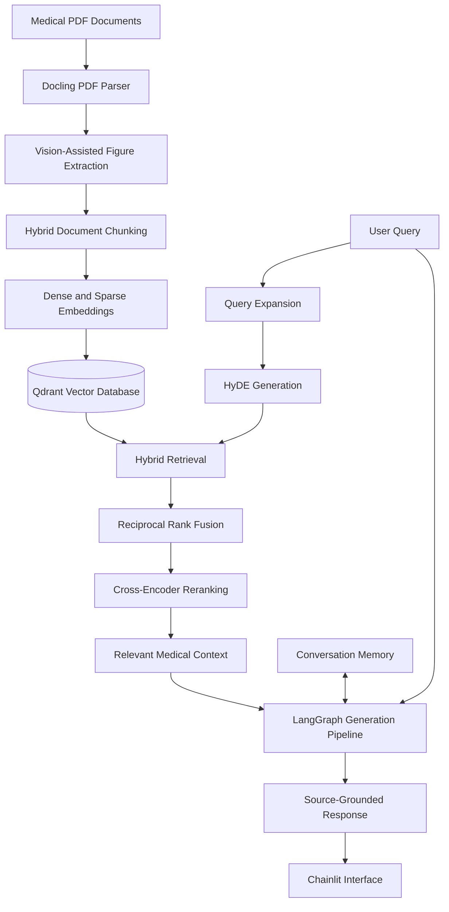

# MedRAG — Medical RAG Assistant

**Multilingual Medical Document Intelligence | Advanced RAG · Hybrid Search · LangGraph**

MedRAG is an AI-powered medical document retrieval and question-answering system built using advanced Retrieval-Augmented Generation (RAG) techniques.

The application enables users to interact with medical documents in Egyptian Arabic and English, combining document parsing, semantic retrieval, query expansion, cross-encoder reranking, and source-grounded answer generation.

Designed with a modular architecture, MedRAG demonstrates how modern AI retrieval techniques can improve access to complex medical information while incorporating safeguards to reduce unsupported responses.

## Project Overview

Medical literature contains large volumes of complex information distributed across clinical guidelines, textbooks, research papers, and reference documents.

Traditional keyword-based search may struggle with informal patient language, multilingual queries, and variations in medical terminology.

MedRAG addresses these challenges through a multi-stage retrieval and generation pipeline that transforms medical documents into searchable knowledge and retrieves relevant evidence before generating responses.

The system is intended for medical information retrieval, research, and experimentation with advanced RAG architectures.

## Key Features

| Feature | Description |
|---|---|
| Medical Document Processing | Extracts structured content from PDF documents using Docling. |
| Vision-Assisted Extraction | Supports figure interpretation using configurable vision-language models. |
| Intelligent Chunking | Combines semantic and recursive chunking strategies. |
| Multilingual Query Processing | Supports Egyptian Arabic and English medical inquiries. |
| Query Expansion | Maps informal Arabic expressions to more clinically relevant terminology. |
| HyDE | Generates hypothetical document representations to support semantic retrieval. |
| Hybrid Search | Combines BGE-M3 dense embeddings with BM25 sparse retrieval. |
| Reciprocal Rank Fusion | Merges dense and sparse retrieval results into a unified ranking. |
| Cross-Encoder Reranking | Refines retrieval relevance using `bge-reranker-large`. |
| Conversational Memory | Maintains conversational context through a LangGraph-based workflow. |
| Grounded Answer Generation | Uses retrieved medical documents to support generated answers. |
| Source Attribution | Provides document references, including filenames and page numbers. |
| Interactive Interface | Chainlit UI with streaming responses, PDF upload, and source cards. |
| Flexible LLM Integration | Supports Groq-hosted models and local Ollama inference. |

## Technology Stack

| Component | Technology |
|---|---|
| Programming Language | Python |
| RAG Orchestration | LangGraph, LangChain |
| Document Parsing | Docling |
| Vision Processing | Gemini / Llama Vision |
| Embedding Model | BAAI/bge-m3 |
| Sparse Retrieval | BM25 |
| Vector Database | Qdrant |
| Ranking Fusion | Reciprocal Rank Fusion (RRF) |
| Reranking Model | BAAI/bge-reranker-large |
| LLM Providers | Groq, Ollama |
| User Interface | Chainlit |
| Vector Database Deployment | Docker |

## System Architecture

MedRAG follows a multi-stage architecture consisting of document ingestion, query augmentation, retrieval, reranking, and grounded response generation.



The architecture separates document processing from query-time retrieval, enabling modular development and independent optimization of each stage.

## RAG Pipeline

### 1. Document Ingestion

The ingestion pipeline processes medical PDF documents and prepares them for retrieval.

**Document Parsing**

Docling extracts textual and structural information from medical PDFs.

**Vision-Assisted Processing**

A configurable vision-language model can provide additional interpretation of figures and visual elements extracted from documents.

**Hybrid Chunking**

Documents are divided into retrieval-friendly segments using a combination of semantic and recursive chunking.

**Vector Storage**

Processed chunks are indexed in Qdrant using dense and sparse representations.

This pipeline prepares structured medical knowledge for subsequent retrieval operations.

### 2. Query Augmentation

Medical questions may contain informal expressions, abbreviations, or terminology that differs from the language used in clinical literature.

MedRAG incorporates two query-processing approaches.

**Arabic-to-Clinical Query Expansion**

Informal Arabic medical expressions are expanded into terminology more closely aligned with clinical documents.

For example:

`بطني بتوجعني` → `Abdominal pain`

**Hypothetical Document Embeddings (HyDE)**

HyDE generates a hypothetical document relevant to the user's question and uses its embedding to support semantic retrieval.

The objective is to improve the representation of informal or underspecified queries when searching specialized medical content.

### 3. Hybrid Retrieval

MedRAG combines two complementary retrieval strategies.

**Dense Retrieval — BGE-M3**

Dense embeddings capture semantic relationships between queries and document passages.

For example, phrases such as "heart attack" and "myocardial infarction" may share similar semantic representations.

**Sparse Retrieval — BM25**

Sparse retrieval supports exact terminology matching, including medical abbreviations, laboratory markers, and specialized clinical expressions.

**Reciprocal Rank Fusion (RRF)**

RRF combines candidate rankings from the retrieval methods to create a unified result list.

This approach is designed to balance semantic relevance with exact-term matching.

### 4. Cross-Encoder Reranking

After hybrid retrieval, candidate passages are evaluated using `bge-reranker-large`.

Unlike independent embedding comparisons, the cross-encoder evaluates the query and passage together to estimate their relevance.

The reranked passages are used to construct a more focused context for answer generation.

### 5. Grounded Answer Generation

The generation layer uses LangGraph to coordinate conversational processing and response generation.

The language model receives the user's question, retrieved medical passages, and relevant conversation context.

The generation workflow is designed to:

- Prioritize information supported by retrieved documents.
- Include source references when available.
- Avoid unsupported medical claims.
- Identify questions that cannot be answered reliably from the available context.
- Respond in Arabic or English according to the user's language.

Prompt-level safeguards reduce risk but do not guarantee factual correctness or clinical safety.

## Project Structure

```text
MedRAG/
├── src/
│   ├── config.py
│   ├── ingestion/
│   │   ├── parser.py
│   │   └── chunker.py
│   ├── embeddings/
│   │   └── embedder.py
│   ├── storage/
│   │   └── qdrant_db.py
│   ├── retrieval/
│   │   ├── expansion.py
│   │   └── searcher.py
│   ├── generation/
│   │   └── llm_chain.py
│   └── app.py
├── ingest.py
├── requirements.txt
├── .env
└── chainlit.md
```

**Core Components**

- `config.py` — Application settings and LLM provider configuration.
- `parser.py` — PDF parsing and vision-assisted content extraction.
- `chunker.py` — Semantic and recursive document chunking.
- `embedder.py` — Dense and sparse embedding generation.
- `qdrant_db.py` — Vector database operations and document indexing.
- `expansion.py` — Query expansion and HyDE processing.
- `searcher.py` — Hybrid retrieval, ranking fusion, and reranking.
- `llm_chain.py` — LangGraph generation workflow and conversation context.
- `app.py` — Chainlit user interface.
- `ingest.py` — Command-line document ingestion.

## Quick Start

### Prerequisites

- Python 3.10+
- Docker for running Qdrant
- Groq API credentials or a configured local Ollama instance
- Google API credentials if using Gemini-based vision processing

### Installation

Clone the repository and create a Python virtual environment:

```bash
git clone <repository-url>
cd MedRAG

python -m venv .venv
```

Activate the virtual environment.

**Windows**

```powershell
.venv\Scripts\activate
```

**macOS / Linux**

```bash
source .venv/bin/activate
```

Install the required dependencies:

```bash
pip install -r requirements.txt
```

### Start Qdrant

Run Qdrant locally using Docker:

```bash
docker run -d \
  --name medrag-qdrant \
  -p 6333:6333 \
  -p 6334:6334 \
  -v qdrant_storage:/qdrant/storage \
  qdrant/qdrant
```

The Qdrant REST API will be available at:

`http://localhost:6333`

### Environment Configuration

Configure the application's existing `.env` file with the required credentials and provider settings.

Example provider configuration:

```dotenv
LLM_PROVIDER=groq
GROQ_API_KEY=your_groq_api_key
GOOGLE_API_KEY=your_google_api_key
```

For a public repository, provide a sanitized `.env.example` and keep the real `.env` excluded from version control.

### Ingest Medical Documents

Ingest an entire directory of PDF documents:

```bash
python ingest.py --dir /path/to/medical_pdfs
```

Ingest selected files:

```bash
python ingest.py --files cardiology.pdf nephrology.pdf
```

Recreate the collection and reindex documents:

```bash
python ingest.py --recreate --dir /path/to/pdfs
```

### Launch the Application

Start the Chainlit interface:

```bash
chainlit run src/app.py -w --port 8000
```

Open:

`http://localhost:8000`

## LLM Provider Configuration

MedRAG uses a provider-configurable language model architecture.

The application supports Groq-hosted inference and local inference through Ollama.

For example, to use Ollama:

```dotenv
LLM_PROVIDER=ollama
OLLAMA_MODEL=gemma3:9b
OLLAMA_BASE_URL=http://localhost:11434
```

The application resolves its configured LLM provider through `get_llm_client()`.

Provider switching is designed to avoid changes to downstream retrieval and generation modules, provided the configured model supports the required interfaces.

## Clinical Safety & Responsible Use

MedRAG is a medical information retrieval research project, not a clinically validated diagnostic system.

The application includes prompt-level safeguards intended to reduce unsupported or potentially unsafe medical responses.

These include:

- Grounding generated answers in retrieved medical documents.
- Avoiding fabricated medication dosages and laboratory values.
- Identifying insufficient retrieval context.
- Including source references with document filenames and page numbers.
- Encouraging consultation with qualified healthcare professionals.
- Supporting language-appropriate responses.

**Important:** These mechanisms do not eliminate hallucinations, guarantee medical accuracy, or replace clinical review.

MedRAG is not intended to independently diagnose medical conditions, recommend treatment, prescribe medication, or guide emergency decisions.

Any use involving real patient information would require appropriate privacy, security, regulatory, and clinical validation measures.

## Performance & Evaluation

The retrieval pipeline is designed to balance answer relevance, retrieval quality, and response latency.

The following figures represent initial engineering estimates rather than measured benchmark results.

| Pipeline Stage | Estimated Latency |
|---|---|
| Query Expansion | ~300 ms |
| HyDE Generation | ~500 ms |
| Hybrid Retrieval | ~50 ms |
| Cross-Encoder Reranking | ~400 ms |
| LLM Generation | ~1–3 s to first token |

End-to-end latency will vary depending on hardware, model availability, document volume, external API latency, and configuration.

**No verified end-to-end latency or retrieval-quality benchmark is claimed at this stage.**

### Recommended Evaluation Metrics

Future evaluation can include:

- Recall@K and Precision@K for retrieval quality.
- Mean Reciprocal Rank (MRR) and nDCG for ranking performance.
- Faithfulness and answer relevance using RAG evaluation frameworks.
- Source citation accuracy.
- Arabic medical query retrieval performance.
- End-to-end latency and time to first token.
- Clinical safety evaluation with qualified domain experts.

These measurements would help assess the contribution of query expansion, hybrid retrieval, and reranking to overall system performance.

## Current Limitations

- Response quality depends on the accuracy and coverage of indexed medical documents.
- Query expansion and HyDE may introduce additional latency.
- Vision-based document processing depends on model availability and document quality.
- Cross-encoder reranking may increase CPU or GPU resource requirements.
- Retrieved source passages may contain incomplete, outdated, or conflicting medical information.
- Prompt-level safeguards cannot guarantee the absence of hallucinations.
- Clinical validation and production deployment requirements have not been established.

## Future Improvements

Potential development directions include:

- Automated RAG evaluation and benchmarking.
- Clinical terminology normalization.
- More comprehensive Arabic medical query testing.
- Enhanced citation verification.
- Improved retrieval performance through caching and optimization.
- Role-based access control and secure document management.
- Clinical expert review workflows.
- Monitoring and observability for retrieval and generation performance.

## Project Information

**Project:** MedRAG — Medical RAG Assistant

**Category:** Generative AI / Retrieval-Augmented Generation / Medical Information Retrieval

**Developer:** Seif Eldeen Hassan

**Purpose:** Research and development of a multilingual medical document retrieval system using advanced RAG techniques.

---

*MedRAG is intended for research, education, and technical demonstration. It is not a substitute for professional medical judgment or a clinically certified decision-support system.*
